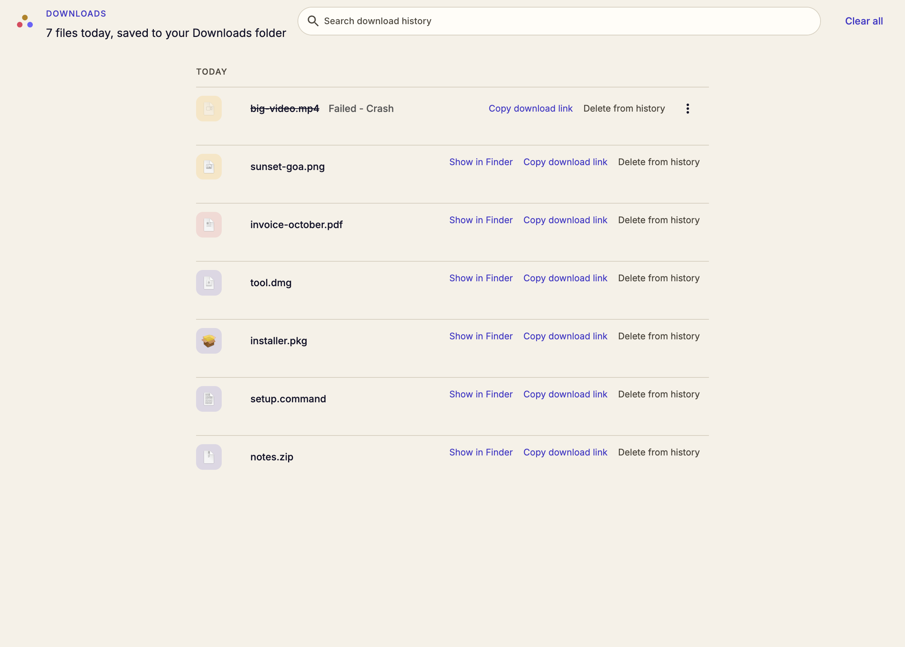
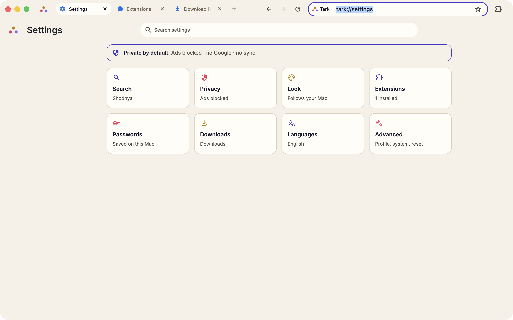
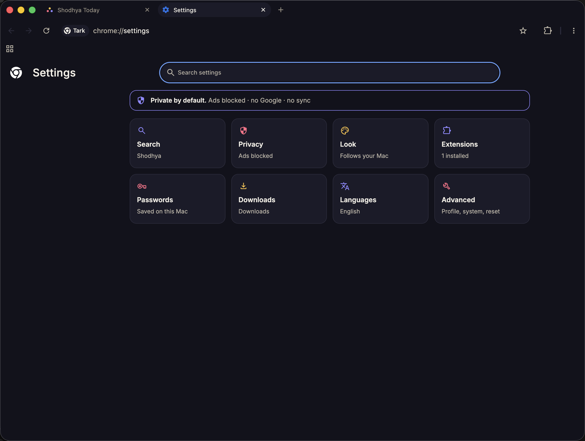

# Tark

Tark is a Chromium browser for macOS with no tracking and nothing extra:
no telemetry, no account, no sync, no Google services unless you turn one
on. It is built on [ungoogled-chromium](https://github.com/ungoogled-software/ungoogled-chromium),
searches [Shodhya](https://shodhya.com) by default, and looks like it.
Everything Tark changes is a patch under `patches/` or a build-time
substitution; the Chromium tree is never committed.

How to build it is in [docs/building.md](docs/building.md), and how the
patches are kept in [docs/patching.md](docs/patching.md).







Internal pages answer to `tark://` (`tark://settings`, `tark://extensions`),
and the three-dot mark is the only logo the browser shows.

## Build

See [docs/building.md](docs/building.md). The short version, on an Apple
Silicon Mac with the toolchain installed:

```sh
./dev.sh setup
./dev.sh build
./dev.sh run
```

## Licence

Tark's own patches and scripts: BSD 3-Clause (`LICENSE`). Upstream
ungoogled-chromium: `LICENSE.ungoogled_chromium`. `utils/name_substitution.py`
and `utils/name_substitution_utils.py` are borrowed from Helium under GPL-3.0
(`LICENSE.GPL-3.0`); they run at build time only, and their output is
Chromium's own string data, so the browser binary is not covered by them.
